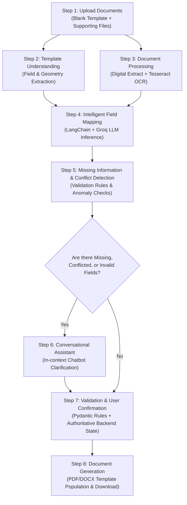
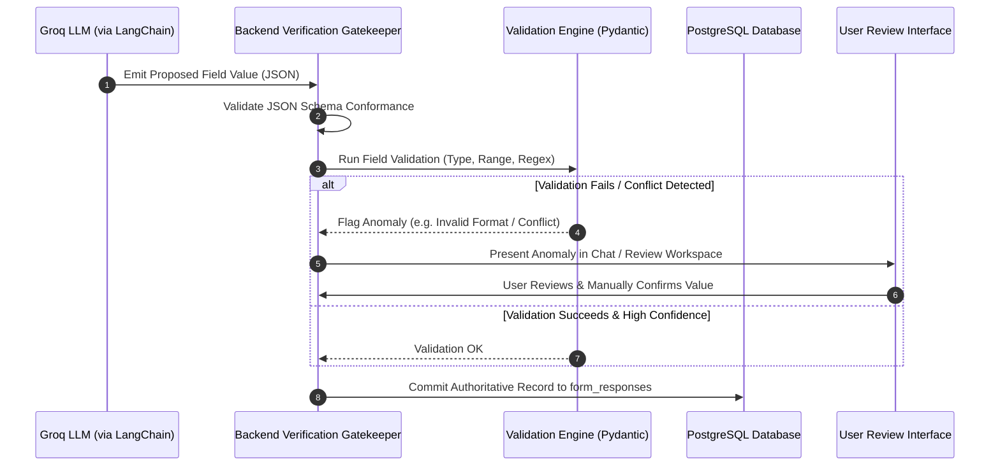
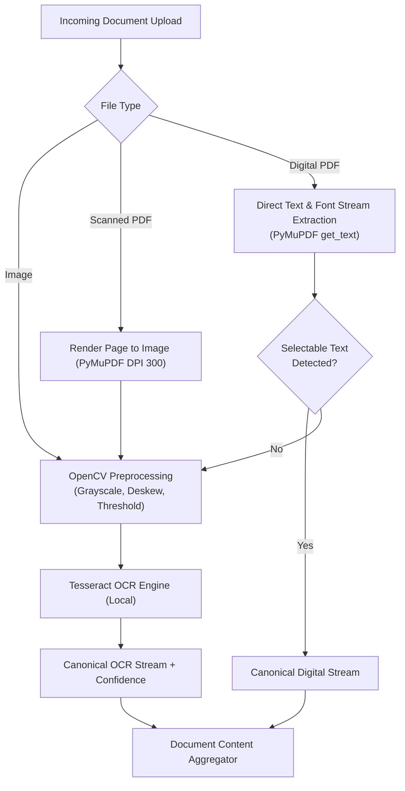
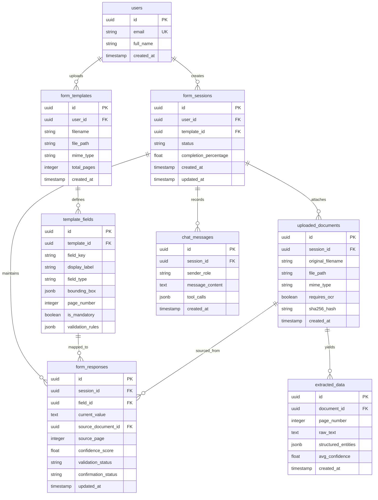
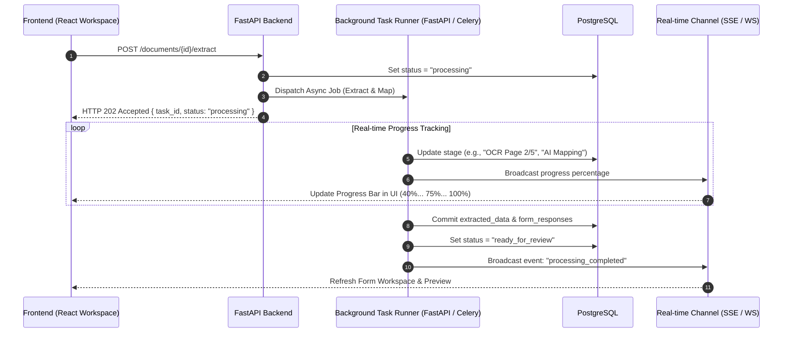
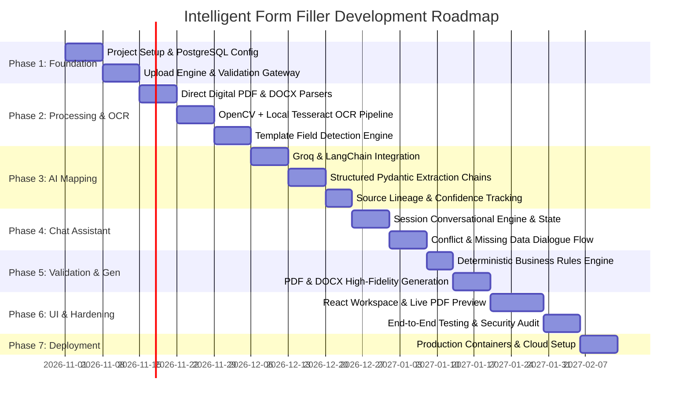

# Intelligent Form Filler: Complete System Architecture & Technical Specifications

> **Project Title:** Intelligent Form Filler — AI-Powered Document Understanding and Automated Form Completion System  
> **Project Type:** AI / Machine Learning / Full-Stack Application  
> **Current Status:** Architecture and Planning  
> **Core AI Provider:** Groq API (Cloud-based LLM Inference)  
> **AI Orchestration Framework:** LangChain  
> **Backend Stack:** Python 3.11+, FastAPI, SQLAlchemy, Pydantic  
> **Frontend Stack:** React 18+, TypeScript, Tailwind CSS, shadcn/ui, TanStack Query  
> **Database:** PostgreSQL (with SQLAlchemy ORM)  
> **OCR & Document Processing:** Tesseract OCR, OpenCV, Pillow, PyMuPDF (fitz), pypdf, python-docx, openpyxl  

---

## 1. Project Overview & Vision

### 1.1 Executive Summary
The **Intelligent Form Filler** is a generic, AI-powered enterprise-grade application engineered to eliminate the manual overhead, cognitive strain, and high error rates inherent in completing structured forms from heterogeneous source documents. 

In conventional workflows, users must manually locate personal, educational, professional, and financial records across multiple physical or digital files (e.g., PAN cards, Aadhaar identity documents, salary slips, bank statements, transcripts, utility bills) and manually transcribe those details into target blank forms. This repetitive data entry is error-prone, mentally tedious, and vulnerable to formatting discrepancies, missed mandatory constraints, and conflicting data points.

The Intelligent Form Filler automates this entire lifecycle:
1. Users upload a **blank form template** (PDF, DOCX, etc.).
2. Users upload one or more **supporting documents** (digital PDFs, scanned images, photos, DOCX files).
3. The platform parses both inputs via **digital extraction and local OCR**, establishes document geometry and field metadata, and uses an **AI Mapping Engine** to correlate extracted attributes with target template fields.
4. When information is missing, conflicting, ambiguous, or invalid, an **integrated Conversational AI Assistant** engages the user to solicit confirmation or clarifications in natural language.
5. After deterministic validation against schema rules and human review, the platform **generates a filled final document**, preserving the exact visual layout, styling, and structural geometry of the original template.

### 1.2 Vision Statement
To establish a high-precision, document-driven form-completion platform that acts as a universal, reusable form-filling engine across industries, minimizing manual data entry while maximizing accuracy, source traceability, and data integrity.

### 1.3 Target Domains & Potential Applications
The architecture is deliberately domain-agnostic. The initial MVP focuses on a generalized engine capable of executing any structured form-filling workflow, including:

- **Taxation & Financial Compliance:** Income tax returns, GST declarations, tax credit filings.
- **Higher Education & Academia:** College admission applications, scholarship requests, transcript evaluations.
- **Human Resources & Talent Acquisition:** Job applications, employee onboarding, benefits enrollment, internship submissions.
- **Banking, Lending & Insurance:** Policy issuance forms, claim processing, loan applications, KYC/AML verification.
- **Government Services & Public Sector:** Civil registration, visa and passport applications, licensing, subsidy applications.
- **Healthcare & Clinical Intake:** Patient registration, clinical history forms, medical billing forms.
- **Custom Enterprise Workflows:** Vendor onboarding, compliance questionnaires, contract execution forms.

---

## 2. Problem Statement & Challenges

Completing forms manually demands that users act as manual ETL (Extract, Transform, Load) pipelines: they must read raw documents, extract values, transform units/formats, identify corresponding target fields, and write values without formatting corruptions.

```
+-----------------------------------------------------------------------------------+
|                           Conventional Manual Workflow                            |
+-----------------------------------------------------------------------------------+
| [Multi-source Docs] -> [Manual Search] -> [Manual Interpretation] -> [Manual Typing] |
|                     High Friction | Error Prone | Inconsistent                     |
+-----------------------------------------------------------------------------------+

+-----------------------------------------------------------------------------------+
|                       Intelligent Form Filler Workflow                            |
+-----------------------------------------------------------------------------------+
| [Multi-source Docs]                                                               |
|          +          -> [Doc Intelligence & OCR] -> [AI Mapping] -> [Auto-Fill & Review]
| [Blank Form Master]                                                               |
|                     Zero Friction | Verified Lineage | Exact Layout                |
+-----------------------------------------------------------------------------------+
```

### Critical Challenges Solved
1. **Repeated Manual Data Entry:** Eliminates typing the same personal and financial data across disparate paperwork.
2. **Multi-Document Synthesis:** Automatically aggregates fragmented data distributed across separate files (e.g., matching salary from a payslip with an account number from a bank statement).
3. **Data Entry Accuracy:** Drastically reduces transcription typos, inverted digits, and misspelled names.
4. **Omission of Mandatory Fields:** Prevents form submission failures by detecting and alerting on missing mandatory attributes upfront.
5. **Conflict Resolution:** Detects when two documents state contradictory facts (e.g., divergent dates of birth or mismatched addresses) and initiates human confirmation.
6. **Domain Jargon & Field Ambiguity:** Demystifies unfamiliar legal, tax, or regulatory fields through an interactive AI conversational assistant.
7. **Preparation Latency:** Reduces document assembly time from hours to seconds.
8. **Preservation of Document Structure:** Eliminates visual layout degradation, misaligned tables, or broken font hierarchies common in traditional PDF editing software.

---

## 3. End-to-End Solution Architecture & 8-Step Workflow



### Detailed Breakdown of the 8 Operational Steps

#### Step 1: Upload Documents
- **Template Intake:** Users upload a single blank form template (`.pdf`, `.docx`, future `.xlsx`).
- **Supporting Documentation Intake:** Users upload one or more evidence files containing raw information (digital PDFs, scanned images in `.png`, `.jpg`, `.jpeg`, `.tiff`, and `.docx`).
- **Input Sanitization:** Multi-part MIME verification, file size validation, malware checks, and secure directory isolation.

#### Step 2: Template Understanding
- Inspects the blank template to construct a canonical field registry.
- Detects field labels, bounding input rectangles, tables, multi-column blocks, radio buttons, and checkboxes.
- Categorizes fields into mandatory, optional, conditional, and formatted constraints (e.g., regex-based postal codes, dates, phone numbers).

#### Step 3: Document Processing
- Executes dual-path text extraction: native text parsing for machine-readable documents, and preprocessed local OCR (Tesseract + OpenCV) for scanned images.
- Normalizes extracted text, detects tabular arrays, and extracts entities (dates, names, addresses, identification codes, currency figures).

#### Step 4: Intelligent Field Mapping
- The AI mapping engine compares extracted entities against the template's detected fields.
- **Traceability Guarantee:** Maps each proposed field value with a reference to its `source_document`, `source_page`, and an extraction `confidence_score`.

| Template Field | Extracted Value | Source Document | Confidence |
| :--- | :--- | :--- | :--- |
| **Full Name** | Jane Doe | `PAN_Card.pdf` (Page 1) | 0.98 |
| **Date of Birth** | 1992-05-14 | `Aadhaar_Card.pdf` (Page 1) | 0.97 |
| **Annual Income** | ₹12,50,000 | `Salary_Slip_Mar2026.pdf` (Page 1) | 0.94 |
| **Bank Account No** | 00921040001284 | `Bank_Statement.pdf` (Page 2) | 0.96 |

#### Step 5: Missing Information & Conflict Detection
- Scans proposed mappings against the template's validation schema.
- Identifies unmapped mandatory fields, detects conflicting candidates from differing sources (e.g., different spelling of names or conflicting addresses), highlights low-confidence extractions (< 0.70), and flags format anomalies.

#### Step 6: Conversational Assistance
- An integrated chatbot engages the user in targeted dialogue to resolve ambiguities.
- Chatbot can prompt for missing information, explain unfamiliar legal/tax terminology, ask for confirmation between conflicting values, and handle conditional form logic.

#### Step 7: Validation and Confirmation
- User reviews mapped fields on an interactive dashboard alongside source citations.
- Deterministic Pydantic validation guarantees syntactic and semantic validity before changes are committed to the authoritative backend state.

#### Step 8: Document Generation
- Injects validated values directly into the original blank template coordinates or form fields.
- Emits high-fidelity completed PDF/DOCX files preserving typography, table margins, alignment, and formatting.

---

## 4. System Architecture & Component Design

### 4.1 High-Level Architecture Stack

```
+-----------------------------------------------------------------------------------+
|                                 PRESENTATION LAYER                                |
|   React 18+  *  TypeScript  *  Tailwind CSS  *  shadcn/ui  *  TanStack Query      |
+-----------------------------------------------------------------------------------+
                                       |  HTTP/REST / WebSockets
                                       v
+-----------------------------------------------------------------------------------+
|                               API & BUSINESS LOGIC                                |
|                       FastAPI  *  Pydantic  *  SQLAlchemy                         |
+-----------------------------------------------------------------------------------+
       |                          |                             |
       v                          v                             v
+---------------+        +------------------+        +--------------------+
|  AI LAYER     |        | DOCUMENT & OCR   |        | PERSISTENCE LAYER  |
| LangChain     |        | PyMuPDF / pypdf  |        | PostgreSQL         |
| Groq LLM API  |        | python-docx      |        | Local Storage /    |
| Pydantic Parse|        | Tesseract OCR    |        | Media File System  |
| Provider Abstr|        | OpenCV / Pillow  |        |                    |
+---------------+        +------------------+        +--------------------+
```

### 4.2 Architectural Data Flow
```
[User Browser]
      |
      | 1. Upload Template & Supporting Docs (POST /templates, POST /documents)
      v
[FastAPI Gateway]
      |
      | 2. File Persistence & Metadata Registration
      v
[Document Processing Engine] <--------+
      |                               |
      +--> Selectable Text?           |
      |         |                     |
      |     [Yes] Direct Parser       |
      |     [No]  OpenCV Preprocessing -> Tesseract OCR Engine
      v
[Extracted Canonical Records]
      |
      | 3. Structured Mapping Request
      v
[AI Mapping Engine (Groq + LangChain)]
      |
      | 4. Proposed Mappings with Confidence & Lineage
      v
[Validation Engine] <------- [Predefined Rules & Constraints]
      |
      | 5. Anomaly Detection (Missing, Invalid, Conflicts)
      v
[Conversational Assistant] <-> [User Resolution in Chat Workspace]
      |
      | 6. Final User Confirmation
      v
[Authoritative Session State (PostgreSQL)]
      |
      | 7. Generation Trigger (POST /sessions/{id}/generate)
      v
[Document Generation Engine (PyMuPDF / python-docx)]
      |
      | 8. Export Completed Artifact
      v
[Completed Form PDF/DOCX Download]
```

### 4.3 Core Application Modules & Responsibilities

#### 1. Template Processing Engine
- **MIMEs Supported:** PDF (form XFA/AcroForms & flattened printable forms), DOCX.
- **Responsibilities:**
  - Ingests template documents without altering byte structures.
  - Detects form widgets, underlines, bracketed fill-in areas, tables, and checkboxes.
  - Maps 2D spatial coordinates $(x, y, w, h)$ and page indices for every target field.
  - Classifies field semantics (e.g., identifies that "SSN / PAN" requires a specific regex pattern).

#### 2. Document Intelligence Engine
- **Responsibilities:**
  - Parses uploaded evidence files into structured text chunks and key-value pairs.
  - Extracts tabular data from digital documents with column/row boundary integrity.
  - Normalizes heterogeneous data representations (e.g., translates `12th May 1990`, `05/12/1990`, and `1990-05-12` into standard ISO-8601 `1990-05-12`).

#### 3. OCR Engine
- **Responsibilities:**
  - Evaluates image quality, skew angle, and dots-per-inch (DPI).
  - Preprocesses imagery using OpenCV: grayscale conversion, Otsu thresholding, noise reduction, and deskewing.
  - Executes local Tesseract OCR on isolated image regions.
  - Calculates confidence intervals per extracted word/line; flags unreadable segments for user attention.

#### 4. AI Mapping Engine
- **Responsibilities:**
  - Formulates structured prompts combining template field definitions with extracted document content.
  - Uses LangChain's structured output wrappers with Groq LLM inference.
  - Computes contextual similarity, matching synonyms (e.g., mapping "Gross Compensation" to "Annual Income").
  - Emits candidate mappings with detailed document and page lineage.

#### 5. Conversational AI Engine
- **Responsibilities:**
  - Manages session-bound conversation state, maintaining awareness of filled, pending, and disputed fields.
  - Generates clear, non-technical queries to prompt users for missing or conflicting parameters.
  - Translates natural-language user responses into structured schema updates via deterministic tool calls.

#### 6. Validation Engine
- **Responsibilities:**
  - Evaluates all proposed values against strong types: regexes, ISO standards, checksums (e.g., Luhn algorithm, tax ID formats).
  - Evaluates conditional rules (e.g., if `marital_status == "Married"`, require `spouse_name`).
  - Guards the persistence layer: acts as an impermeable firewall preventing unvalidated LLM output from reaching the database.

#### 7. Document Generation Engine
- **Responsibilities:**
  - Populates existing PDF AcroForm fields directly when present.
  - For flattened/scanned PDF templates, performs precise text injection at target bounding coordinates using PyMuPDF, matching font metrics, weight, size, and baseline alignment.
  - For DOCX templates, injects values into target form controls, bookmark anchors, or table cells while preserving typography and styles.

#### 8. Audit and Security Engine
- **Responsibilities:**
  - Records an append-only timeline of all changes, documenting who changed what, when, and based on which document or chat input.
  - Enforces access control and tenant isolation.
  - Handles automated cleanup and secure purging of uploaded files according to data retention policies.

---

## 5. Comprehensive Technology Stack

| Layer | Technology | Version / Tooling | Architectural Purpose |
| :--- | :--- | :--- | :--- |
| **Frontend Framework** | React | `18.3+` | Declarative, component-driven UI for workspace and review dashboards |
| **Language (Frontend)** | TypeScript | `5.0+` | Static typing, interface contracts matching backend Pydantic models |
| **Styling & Design** | Tailwind CSS | `3.4+` | Utility-first styling framework for responsive layouts |
| **UI Components** | shadcn/ui | Radix UI primitives | Accessible, customizable components (Dialogs, Tables, Popovers, Accordions) |
| **State & API Cache** | TanStack Query | `v5+` | Server-state management, cache invalidation, and optimistic UI updates |
| **Backend Framework** | FastAPI | `0.110+` | Asynchronous, high-throughput REST API with native OpenAPI documentation |
| **Language (Backend)** | Python | `3.11+` | Core backend runtime for AI orchestration and document processing |
| **AI Orchestration** | LangChain | `0.2+` | Prompt pipelining, LLM chains, schema parsing, and agent workflows |
| **AI Cloud Provider** | Groq API | Llama 3 / Mixtral | Ultra-fast cloud LLM inference for structural analysis and conversational chat |
| **Data Validation** | Pydantic | `v2+` | Rigorous schema declaration, input sanitization, and output verification |
| **Database** | PostgreSQL | `15+` | ACID-compliant relational data store for metadata, sessions, and audit trails |
| **ORM & Migrations** | SQLAlchemy / Alembic | `2.0+` | Type-annotated async DB interaction and database schema migrations |
| **PDF Processing** | PyMuPDF (fitz) & pypdf | `1.24+` | Digital PDF extraction, geometric coordinate analysis, and direct PDF generation |
| **Word Processing** | python-docx | `1.1+` | Reading, parsing, and modifying `.docx` documents and XML tables |
| **Spreadsheet Parsing**| openpyxl | `3.1+` | Processing tabular worksheets, cells, and formula references |
| **OCR Engine** | Tesseract OCR | `5.3+` | Local image-to-text extraction without external cloud API dependencies |
| **Computer Vision** | OpenCV & Pillow | `4.9+` / `10.2+` | Image deskewing, binarization, noise filtering, and thresholding |

---

## 6. AI & API Strategy

### 6.1 Cost-Effective API Configuration
The architecture prioritizes a zero-cost local development footprint:
- **Groq API:** Utilized as the primary cloud LLM provider to exploit its high-throughput LPUs (Language Processing Units) and free-tier access for development.
- **Tesseract OCR:** Operates 100% locally on the backend host; requires zero paid cloud vision APIs.
- **LangChain:** Open-source coordination library; requires no subscription or proprietary keys.
- **Document Processing Libraries:** Pure open-source Python dependencies (`PyMuPDF`, `python-docx`, `openpyxl`, `OpenCV`).
- **Resilience Policy:** Multi-key round-robin mechanisms designed to circumvent provider limits are strictly prohibited; standard exponential backoff and rate-limit queueing are enforced.

### 6.2 Role of Groq Cloud LLM
Groq provides high-speed structured text processing and conversational reasoning:
1. **Semantic Field Extraction:** Identifies entities from noisy OCR or digital text streams.
2. **Contextual Mapping:** Connects varied source labels (e.g., "Remuneration Details", "Base Pay") to canonical form targets ("Annual Income").
3. **Ambiguity Resolution:** Decides when two pieces of data describe different entities or represent updates over time.
4. **Natural-Language Clarification:** Generates human-friendly, concise questions to resolve anomalies.

### 6.3 Role of LangChain
LangChain standardizes workflow management across the application:
- Standardized prompt templates with system/user context isolation.
- Output parsers ensuring strict JSON adherence via Pydantic schemas.
- Ephemeral and persistent conversation buffer management for session chat.
- Structured tool execution for updating form state during conversational turns.

### 6.4 AI Provider Abstraction Interface
Business logic is decoupled from Groq through a provider-agnostic interface:

```python
from abc import ABC, abstractmethod
from typing import Any, Dict, List
from pydantic import BaseModel

class ExtractionResult(BaseModel):
    entities: Dict[str, Any]
    confidence_scores: Dict[str, float]
    raw_response: str

class MappingProposal(BaseModel):
    field_id: str
    proposed_value: Any
    confidence: float
    rationale: str

class AIProvider(ABC):
    """Abstract Base Class establishing provider independence."""
    
    @abstractmethod
    async def extract_fields(self, document_content: str, extraction_schema: Dict[str, Any]) -> ExtractionResult:
        """Extract structured entities from raw document content."""
        pass

    @abstractmethod
    async def map_fields(self, extracted_entities: Dict[str, Any], template_fields: List[Dict[str, Any]]) -> List[MappingProposal]:
        """Correlate extracted entities against target template fields."""
        pass

    @abstractmethod
    async def generate_response(self, conversation_history: List[Dict[str, str]], current_context: Dict[str, Any]) -> str:
        """Generate conversational clarification messages for missing/conflicting items."""
        pass
```

### 6.5 The AI Reliability Principle (Deterministic Gatekeeping)
The LLM is strictly treated as an **untrusted proposal engine**. It possesses zero authority to commit records to the database or modify final documents directly.



---

## 7. OCR Strategy & Performance Optimization



### 7.1 Proposed OCR Workflow
1. **Document Ingestion:** The file is registered in the database and saved to local storage.
2. **Selectability Detection:** PyMuPDF parses the document stream. If readable text streams exist across pages with standard fonts, direct extraction is selected.
3. **Selective OCR:** If selectable text is absent, sparse (< 50 words per page), or rendered as vector paths, the system falls back to image rendering.
4. **Image Optimization:** Pages are rendered to raster images at 300 DPI, followed by OpenCV-based noise reduction and deskewing.
5. **Local Tesseract Parsing:** Tesseract processes the image, outputting character arrays, bounding boxes, and confidence levels.
6. **Result Cache:** Extracted text and spatial coordinates are cached in `extracted_data` to ensure zero redundant OCR passes.

### 7.2 Optimization Tactics
- **Bypass Redundant Processing:** Digital PDFs skip OCR entirely, yielding an ~8x processing speedup.
- **Multiprocessing Worker Pools:** Independent PDF pages are preprocessed and OCRed across concurrent worker threads up to CPU core limits.
- **Image Resizing & Downsampling:** Overly dense images (> 600 DPI) are downscaled to 300 DPI, preserving recognition fidelity while cutting memory consumption by 65%.
- **Separation of Concerns:** OCR execution is isolated from LLM mapping requests; OCR output is fully persisted before invoking AI prompts.
- **Content Hashing:** SHA-256 hashes of uploaded files prevent duplicate processing of re-uploaded documents.

---

## 8. Intelligent Field Mapping & Conflict Resolution

### 8.1 Field Schema Specification
Each identified form field maintains an explicit database tracking state:

```
+-------------------------------------------------------------------------------+
|                            Form Field Tracking Record                         |
+-------------------------------------------------------------------------------+
|  field_id             : UUID (Primary Key)                                    |
|  session_id           : UUID (Foreign Key -> form_sessions.id)                |
|  field_name           : String (e.g. "applicant_dob")                         |
|  display_label        : String (e.g. "Date of Birth")                         |
|  field_type           : Enum (text, date, number, currency, checkbox, select) |
|  current_value        : Text (Normalized string representation)               |
|  source_document_id   : UUID (Foreign Key -> uploaded_documents.id)           |
|  source_page          : Integer (1-based page index)                          |
|  confidence_score     : Float (Range: 0.00 to 1.00)                           |
|  validation_status    : Enum (valid, invalid, conflict, missing_mandatory)    |
|  confirmation_status  : Enum (unconfirmed, confirmed_by_user, modified)       |
+-------------------------------------------------------------------------------+
```

### 8.2 Conflict Resolution Mechanism
When contradictory information is discovered across multiple supporting files, the system initiates a structured conflict resolution protocol:

```
Scenario:
- Document A (Aadhaar Card) -> DOB: 14/05/1992
- Document B (Birth Certificate) -> DOB: 24/05/1992

System Behavior:
1. Detects divergent candidate values for target field "date_of_birth".
2. Retains both candidates in the session mapping buffer with metadata:
   - Candidate 1: "1992-05-14" (Aadhaar_Card.pdf, p.1, Confidence: 0.95)
   - Candidate 2: "1992-05-24" (Birth_Certificate.pdf, p.1, Confidence: 0.92)
3. Transitions field validation_status to 'conflict'.
4. Triggers Conversational Assistant to prompt user:
   "I found conflicting dates of birth: 14 May 1992 (from Aadhaar Card) vs 24 May 1992 (from Birth Certificate). Which is correct?"
5. Upon user response, assigns selected value, links source citation, and sets confirmation_status to 'confirmed_by_user'.
```

### 8.3 Conditional Field Dependency Graphs
Forms frequently require dynamic logic:
- If `tax_regime == "New"`, disable `deductions_80c` and `hra_exemption`.
- If `marital_status == "Married"`, require `spouse_full_name`.
- The engine uses a directed acyclic graph (DAG) of dependency rules. When a parent field updates, dependent fields automatically adjust their `validation_status` to mandatory, optional, or inactive.

---

## 9. Conversational Assistant Architecture

### 9.1 Form-Aware Conversational Context
Unlike generic conversational chat bots, this assistant operates with strict access to the live session state:
- Blank template requirements & validation constraints.
- Real-time list of populated, missing, and conflicted fields.
- Verbatim source excerpts and page coordinates.
- Prior user answers and conversational clarification history.

### 9.2 Example Multi-Turn Interaction
```
Assistant: I have extracted your financial details from the uploaded March 2026 Salary Slip. 
           May I confirm that your Annual Gross Compensation is ₹12,50,000?

User:      Yes, that is accurate.

Assistant: Confirmed. However, I could not find your Bank IFSC Code anywhere in the 
           uploaded documents. Could you please provide your IFSC code?

User:      It is HDFC0001234.

Assistant: Thank you! IFSC 'HDFC0001234' is valid for HDFC Bank. I have populated 
           the Bank IFSC Code field on your form. Next, you selected 'Married'—could 
           you confirm your spouse's full legal name?
```

### 9.3 Conversational Capabilities Matrix
- **Targeted Questioning:** Never prompts for fields already extracted with high confidence unless a conflict exists.
- **Plain-Language Explanations:** Explains obscure tax or legal abbreviations (e.g., explains "What is Form 16 Part B?" upon user request).
- **In-Flight Corrections:** Accepts user updates at any point (e.g., "Actually, update my address to 42 MG Road").
- **Live Preview Synchronization:** WebSocket/SSE events broadcast chat updates immediately to the form preview pane.

---

## 10. User Interface & Dashboard Architecture

```
+-----------------------------------------------------------------------------------+
|  [Logo] Intelligent Form Filler            Session: Tax_Filing_2026  [Export Form] |
+-----------------------------------------------------------------------------------+
|  STEP PROGRESS:  (1) Upload -> (2) Processing -> [3] Workspace -> (4) Download    |
+---------------------------------------+-------------------------------------------+
|            FORM PREVIEW PANE          |           INTERACTIVE ASSISTANT           |
|                                       |                                           |
|  [ Page 1 of 3 ]   Zoom: [-] 100% [+] |  +-------------------------------------+  |
|  +---------------------------------+  |  | Assistant:                          |  |
|  | Full Name: [ Jane Doe         ] |  |  | I found ₹12,50,000 for your annual   |  |
|  | DOB:       [ 1992-05-14       ] |  |  | income. Shall I confirm this?       |  |
|  | PAN:       [ ABCDE1234F       ] |  |  +-------------------------------------+  |
|  | IFSC Code: [ HDFC0001234  (!) ] |  |  | User:                               |  |
|  |                                 |  |  | Yes, please confirm.                |  |
|  | (Source: Salary_Slip_p1.pdf)    |  |  +-------------------------------------+  |
|  +---------------------------------+  |                                           |
|                                       |  [ Type response or ask question...   ]   |
+---------------------------------------+-------------------------------------------+
|  METRICS: 18/20 Fields (90%) | 1 Conflict Resolved | 0 Errors | Ready for Review  |
+-----------------------------------------------------------------------------------+
```

### 10.1 Main System Screens
1. **Dashboard:** Displays active sessions, completion percentages, creation dates, and action shortcuts.
2. **Upload Screen:** Dual dropzones for blank templates and supporting files, with automatic MIME detection and progress indicators.
3. **Processing Screen:** Real-time progress tracker reporting Document Parsing $\rightarrow$ OCR Extraction $\rightarrow$ AI Field Mapping.
4. **Form Completion Workspace:** Split-view workspace pairing an interactive PDF/form preview with the AI chatbot and field inspection panel.
5. **Review Screen:** Detailed tabular audit view of every extracted value, confidence score, source file, and validation status, allowing manual overrides.
6. **Download Screen:** Final generation summary with direct downloads for completed PDFs, DOCX files, and cryptographic verification logs.

### 10.2 Real-Time Dashboard Metrics
- **Completion Rate:** Percentage of mandatory fields successfully populated and confirmed.
- **Detected Fields Count:** Total number of target template inputs discovered.
- **Automated Extractions:** Number of fields mapped directly from documents without human intervention.
- **Awaiting User Action:** Total count of conflicts, missing mandatory fields, and format validation warnings.

---

## 11. Relational Database Schema Architecture

The PostgreSQL schema is structured for strict referential integrity, complete audit trails, and efficient querying:



### Future Auxiliary Tables
- `mapping_candidates`: Retains competing extraction proposals prior to conflict resolution.
- `generated_documents`: Catalogs generated outputs, file sizes, and download tokens.
- `audit_logs`: Detailed immutable log of every field edit, user action, and system event.
- `processing_jobs`: Background job queues tracking Celery/FastAPI async task execution.

---

## 12. Complete RESTful API Specifications

| Method | Endpoint | Description | Request Payload / Params | Response Payload |
| :--- | :--- | :--- | :--- | :--- |
| `POST` | `/templates/upload` | Upload blank form template | `multipart/form-data` (`file`) | `{ template_id, filename, pages }` |
| `POST` | `/documents/upload` | Upload supporting documents | `multipart/form-data` (`session_id`, `files[]`) | `[ { doc_id, filename, size, hash } ]` |
| `GET` | `/templates/{id}` | Get template metadata & fields | Path `id` (UUID) | `{ template_id, fields: [...] }` |
| `POST` | `/templates/{id}/analyze` | Trigger field detection on template | Path `id` (UUID) | `{ task_id, status: "processing" }` |
| `POST` | `/documents/{id}/extract` | Trigger OCR & text extraction | Path `id` (UUID) | `{ task_id, status: "extracting" }` |
| `POST` | `/sessions` | Initialize form-filling session | `{ template_id, user_id }` | `{ session_id, status: "created" }` |
| `GET` | `/sessions/{id}` | Get session details & metrics | Path `id` (UUID) | `{ session_id, completion_pct, ... }` |
| `GET` | `/sessions/{id}/fields` | Fetch all fields & values | Path `id` (UUID) | `[ { field_id, label, value, ... } ]` |
| `POST` | `/sessions/{id}/chat` | Send conversational query | `{ message: string }` | `{ reply: string, updated_fields: [...] }` |
| `PATCH`| `/sessions/{id}/fields/{fid}`| Manual user edit on field | `{ value: string, confirm: bool }` | `{ field_id, current_value, status }` |
| `POST` | `/sessions/{id}/validate` | Run validation suite on session | Path `id` (UUID) | `{ is_valid: bool, errors: [...] }` |
| `POST` | `/sessions/{id}/generate` | Generate completed document | `{ format: "pdf" \| "docx" }` | `{ download_url, document_id }` |
| `GET` | `/sessions/{id}/download` | Stream completed output file | Path `id`, query `doc_id` | Binary file stream (`application/pdf`) |

---

## 13. Security, Privacy & Compliance Architecture

Personal identity cards, financial statements, and medical forms demand strict data protection standards:

1. **Multi-Part File Sanitization:** Rejects executable files, verifies magic numbers (not just extensions), and enforces a strict 25MB ceiling per upload.
2. **Access Control & Tenant Isolation:** Every request is authenticated; access to templates, supporting documents, and sessions is scoped strictly to the owning user.
3. **Environment Isolation for Secrets:** All Groq API tokens, database connection URIs, and encryption keys are loaded exclusively from backend environment variables.
4. **Log Scrubbing:** All application logs pass through regex masking filters to prevent personal data (e.g., PANs, SSNs, bank accounts, names) from appearing in stdout or log collectors.
5. **Payload Minimization:** Only relevant document chunks are sent to the LLM for mapping; raw full-document scans are never transmitted in bulk.
6. **Data Masking at Rest & in Transit:** TLS 1.3 for all data in motion; AES-256 for document storage at rest. Sensitive fields (e.g., account numbers) are masked on the frontend (`****-****-1284`) unless actively unlocked by the user.
7. **Document Retention & Deletion:** Users can permanently delete sessions and all associated supporting files. Upon deletion, storage files and database records are scrubbed.
8. **Prompt Injection Hardening:** System prompts enforce strict context boundaries. Uploaded text is treated as raw data input rather than executable model instructions.
9. **Zero-Trust Document Export:** Documents cannot be generated if mandatory field violations or unconfirmed conflicting values remain unresolved.
10. **Provider Terms Review:** Prior to production deployment with real customer documents, cloud AI provider terms (e.g., Groq's data retention and zero-day training policies) must be formally approved.

---

## 14. Comprehensive Error Handling & Edge Cases

| Edge Case / Failure Mode | Root Cause | System Remediation & Recovery Strategy |
| :--- | :--- | :--- |
| **Password-Protected PDF** | Document encrypted at rest | System flags file immediately; prompts user in UI to enter password or re-upload an unencrypted version. |
| **Corrupted / Invalid Files** | Truncated upload or malformed headers | Rejects file at ingestion gateway with HTTP 422; alerts user with a clean error message. |
| **Unsupported File Formats** | Unrecognized file extension/MIME | Reject with list of accepted types (`.pdf`, `.docx`, `.png`, `.jpg`, `.jpeg`). |
| **Blurry Scans / Low DPI** | Substandard camera image or low-res scan | Tesseract low-confidence warning (< 50%); flags page for manual user review in the workspace. |
| **Rotated Pages (90° / 180°)** | Document scanned sideways or inverted | OpenCV automated orientation detection and deskewing via Hough line transforms. |
| **Handwritten Annotations** | Cursive or freehand handwriting | Local OCR flags as low confidence; AI Assistant prompts user to transcribe handwritten sections. |
| **Multi-Person Documents** | Joint bank accounts or family certificates | AI detects multiple candidate names; initiates disambiguation dialogue with the user. |
| **Duplicate Document Uploads** | User uploads identical file twice | SHA-256 hash detection identifies duplicates instantly; reuses existing extraction cache. |
| **Conflicting Data Points** | Different values for same field | Flags field status as `conflict`; Chatbot prompts user with both values and their sources to choose. |
| **Missing Mandatory Fields** | Data absent in all supporting documents | Validation Engine blocks generation; Assistant proactively queries user for the missing values. |
| **Invalid Formats (e.g., Bad Date)** | OCR misinterpreted a digit | Pydantic regex validator catches format error; Chatbot asks user for correction. |
| **Multilingual Documents** | Supporting documents in non-English script | Tesseract language packs (`eng` + target languages); fallback to user clarification. |
| **AI Rate Limiting (Groq 429)** | Exceeded free-tier requests/tokens | LangChain exponential backoff retry; queues requests with user-facing progress updates. |
| **AI Service Outage** | Groq API unreachable (HTTP 502/503) | Graceful degradation: users can still review documents and fill fields manually via the workspace. |
| **OCR Crash / Memory Fault** | Corrupted image vector crashes Tesseract | Process runs in an isolated worker; fails gracefully without crashing the FastAPI backend service. |
| **Generation Geometry Drift** | Target PDF lacks form widgets | Spatial calibration algorithm calculates exact $(x, y)$ coordinate offsets based on anchor text. |

---

## 15. Background Processing & Scalability

Large multi-page PDF documents and high-resolution OCR can take 5 to 30 seconds per document, which is unsuitable for synchronous HTTP request cycles.



- **MVP Architecture:** FastAPI's built-in `BackgroundTasks` processes jobs asynchronously within the application runtime.
- **Enterprise Scale Architecture:** Celery workers backed by a Redis message broker, enabling horizontal scaling across worker nodes for heavy OCR operations.

---

## 16. Cost Strategy & Free-Tier Optimization

The Intelligent Form Filler is designed to operate on a **zero-cost software footprint** during MVP development and initial testing:

| Component | Architecture Solution | Operational Cost Strategy |
| :--- | :--- | :--- |
| **Frontend Host** | React + TypeScript | Zero cost (Vercel / Netlify / local host) |
| **Backend Runtime** | FastAPI (Python) | Zero cost (Local host / Render free tier) |
| **Database** | PostgreSQL | Zero cost (Local Docker / Supabase free tier) |
| **AI Inference** | Groq Cloud API | Zero cost (Groq Developer Free Tier for Llama 3 / Mixtral) |
| **OCR Engine** | Tesseract OCR | Zero cost (100% open-source local binary) |
| **Image Processing** | OpenCV & Pillow | Zero cost (Open-source libraries) |
| **Document Processing** | PyMuPDF, python-docx, openpyxl | Zero cost (Open-source libraries) |
| **AI Orchestration** | LangChain | Zero cost (Open-source Python package) |

> [!NOTE]  
> Free-tier cloud LLM services have changing rate limits. The local caching layer (`extracted_data`) ensures that each unique document is sent to Groq only once.

---

## 17. Phased Implementation Roadmap



### Detailed Phase Milestones
- **Phase 1: Project Foundation & Upload System:** Setup FastAPI + PostgreSQL via SQLAlchemy. Build file upload endpoints with type validation, SHA-256 deduplication, and storage isolation.
- **Phase 2: Template & Document Processing:** Build direct PDF/DOCX parsers and integrate OpenCV deskewing with local Tesseract OCR. Implement template field detection.
- **Phase 3: AI Field Mapping:** Integrate Groq API via LangChain. Implement structured entity mapping, confidence scores, and source document/page tracking.
- **Phase 4: Conversational Assistant:** Implement conversational chat endpoints. Build stateful context management to prompt for missing values and resolve conflicting data points.
- **Phase 5: Validation & Document Generation:** Build deterministic Pydantic validation rules and conditional field logic. Implement high-fidelity PDF coordinate injection and DOCX generation.
- **Phase 6: UI, Testing & Optimization:** Develop React dashboard, split-screen workspace, live PDF viewer, and conversational sidebar. Conduct end-to-end integration and accuracy testing.
- **Phase 7: Deployment & Future Enhancements:** Dockerize services, configure production database backups, add monitoring, and explore optional cloud OCR fallbacks.

---

## 18. Multi-Vector Testing Strategy

```
+-------------------------------------------------------------------------------+
|                                Testing Matrix                                 |
+-------------------------------------------------------------------------------+
|  1. Document Processing Testing                                               |
|     - Machine-readable digital PDFs (single & multi-page)                     |
|     - Scanned noisy PDFs (150-300 DPI, skewed, low contrast)                  |
|     - DOCX templates with complex multi-row tables                            |
|     - Mobile photographs of documents (.jpg, .png) with uneven lighting       |
+-------------------------------------------------------------------------------+
|  2. AI Mapping Accuracy Testing                                               |
|     - High-similarity direct matches ("First Name" -> "First Name")           |
|     - Semantic synonym matches ("Gross Compensation" -> "Annual Income")      |
|     - Missing field detection across incomplete document sets                 |
|     - Conflicting records across documents (mismatched DOB, addresses)        |
+-------------------------------------------------------------------------------+
|  3. Conversational Assistant Testing                                          |
|     - Collecting missing fields via natural language multi-turn dialogue      |
|     - Handling out-of-order user updates and field corrections                |
|     - Verifying context retention throughout long conversations               |
+-------------------------------------------------------------------------------+
|  4. Deterministic Validation Testing                                          |
|     - Date formats (rejecting invalid dates like 2026-02-31)                  |
|     - Identification formats (regex validation for PAN, SSN, IFSC)            |
|     - Conditional field validation (spouse name required only if married)     |
+-------------------------------------------------------------------------------+
|  5. Document Generation High-Fidelity Testing                                 |
|     - Visual layout inspection: zero font baseline drift                      |
|     - Proper text wrapping within bounded target table cells                  |
|     - Accurate checkbox and radio button marking                              |
+-------------------------------------------------------------------------------+
|  6. Security & Hardening Testing                                              |
|     - Enforcing file size ceilings and blocking malicious file types          |
|     - Prompt injection defenses in supporting document text                   |
|     - Verification of log scrubbing for sensitive personal information        |
+-------------------------------------------------------------------------------+
```

---

## 19. Future Enhancements & Long-Term Roadmap

1. **Spreadsheet Form Support:** Direct population of complex multi-tab `.xlsx` models with formula preservation.
2. **Specialized Handwriting Recognition:** Integration of vision models to read non-standard handwriting and signatures.
3. **Multilingual OCR Support:** Expand support to 50+ languages with automatic script detection.
4. **Cloud AI Provider Redundancy:** Automatic failover across multiple providers (e.g., Groq $\rightarrow$ Anthropic $\rightarrow$ OpenAI) to handle outages.
5. **Visual Layout Understanding:** Deep layout analysis via models like LayoutLM for complex multi-column documents.
6. **Reusable Organization Templates:** A shared template repository for standardized forms (e.g., standard W-2, Form 16, common university admissions).
7. **Document Diffing & Comparison:** Visual side-by-side comparison between uploaded documents to highlight discrepancies.
8. **Automated Deduplication Engine:** Clustering algorithms to detect when uploaded documents contain redundant information.
9. **Role-Based Access Control (RBAC):** Organization and enterprise accounts with granular role-based permissions (Auditor, Reviewer, Applicant).
10. **Immutable Audit Trails:** Cryptographically verifiable hash chains documenting all changes made to a form.
11. **Cloud Object Storage:** Integration with S3/GCS-compatible object storage for production deployments.
12. **Smart Form Recommendations:** Suggesting the appropriate form template based on uploaded supporting documents.
13. **Enterprise DMS Integration:** Direct import/export with platforms like SharePoint, Google Drive, and Box.

---

## 20. Ten Core Architectural Principles

1. **Generic by Design:** The core engine is completely domain-agnostic. It processes income tax forms, college applications, and insurance claims with equal fidelity using the same underlying pipeline.
2. **Backend as the Single Source of Truth:** The frontend is a presentation layer; the backend database manages session states, validation rules, and document artifacts.
3. **AI-Assisted, Not AI-Controlled:** AI models propose mappings; deterministic backend logic validates, constraints, and applies them.
4. **Complete Source Traceability:** Every populated field is linked directly to its source document, page number, and extraction confidence score.
5. **Mandatory Human Confirmation:** Uncertain, conflicting, or low-confidence values require explicit user review before document finalization.
6. **Optimized OCR Execution:** Direct digital text extraction is always prioritized; local OCR is used only when scanned or image content is detected.
7. **AI Provider Independence:** An abstract interface decouples business logic from specific AI vendors, allowing seamless provider switches.
8. **Privacy & Security by Design:** Strong data minimization, payload scrubbing, access control, and secure deletion policies protect user data.
9. **Modular Engine Decoupling:** The 8 core engines (Template, Document, OCR, AI Mapping, Conversational, Validation, Generation, Security) operate as decoupled, testable modules.
10. **Preservation of Document Fidelity:** Generated documents retain the exact typography, spatial layout, and formatting of the original template.

---

## 21. Summary & Next Steps

The **Intelligent Form Filler** transforms a historically manual, error-prone chore into an automated, verified, and streamlined experience. By combining local document extraction and OCR, LangChain coordination, high-speed Groq LLM inference, conversational clarification, and deterministic validation, the system delivers end-to-end form completion with verified accuracy.

**Immediate Next Steps for Project Implementation:**
1. Initialize the FastAPI backend project structure and configure the local PostgreSQL database using Docker.
2. Initialize the React + TypeScript frontend using Vite, Tailwind CSS, and shadcn/ui.
3. Implement Step 1 & 2: Template and supporting document upload endpoints with direct text extraction and Tesseract OCR integration.
